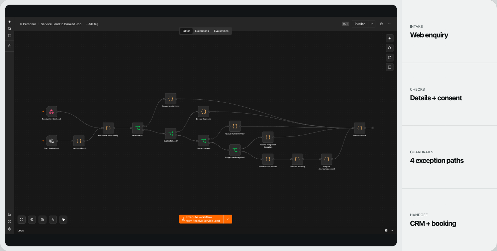
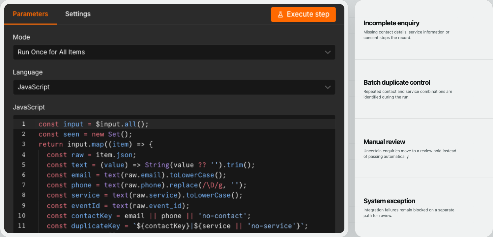
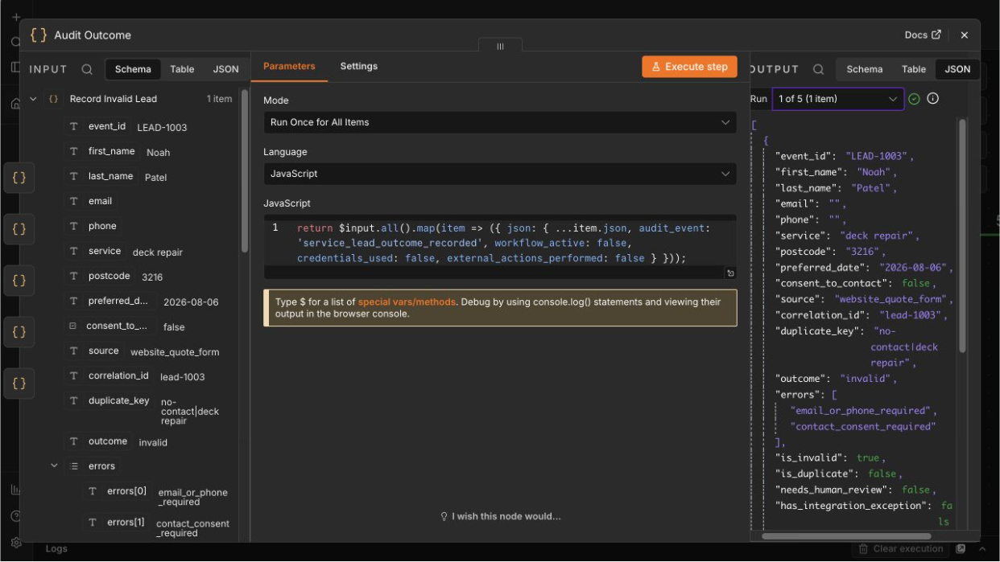

# n8n Service Lead Routing

A 16-node n8n workflow for validating service enquiries, separating duplicates and exceptions, and preparing clean CRM, booking and acknowledgement handoffs.

| | |
| --- | --- |
| Status | Built and import-tested |
| Role | Workflow design, routing logic, test scenarios and operator handoff |
| Stack | n8n, JavaScript, JSON workflow contracts |
| Project page | [smsystems.au/work/n8n-service-lead-routing](https://smsystems.au/work/n8n-service-lead-routing/) |

## Routing model

The workflow accepts a service enquiry through either a webhook or a manual review run. It normalises contact details and service data before sending the record through five explicit outcomes:

| Outcome | Treatment |
| --- | --- |
| Accepted | Prepare CRM record, proposed booking and acknowledgement preview |
| Duplicate | Stop further preparation and retain the matching key |
| Invalid | Record missing contact, consent or service fields |
| Human review | Hold CRM and booking actions with a review reason |
| Integration exception | Block downstream preparation and record the adapter failure |

```text
webhook or manual batch
          │
          ▼
normalise and classify
          │
          ▼
invalid ─ duplicate ─ human review ─ integration exception
                                             │
                                             ▼
                                 CRM and booking preparation
                                             │
                                             ▼
                                       audit outcome
```



## Workflow decisions

### Validation runs before handoff

Contact method, service, location and consent are checked before the workflow prepares a CRM record or booking.

### Duplicate handling uses a stable business key

Email or normalised phone is combined with the service type. A second event with the same key follows the duplicate route instead of creating another handoff.

### Human review is separate from invalid data

A complete record can still require judgment. Licensed-trade scope, scheduling ambiguity or another operating concern can hold the record without treating it as malformed.

### External actions remain disabled

The included workflow prepares destination-shaped data but does not send acknowledgements, create bookings or write to a CRM. Those adapters require separate credentials and an approved activation step.





## Included scenarios

The committed fixture runs one record through each outcome:

- accepted website enquiry;
- duplicate submission with case-normalised email;
- missing contact method and consent;
- complete enquiry requiring human review;
- simulated destination-adapter failure.

The expected output records correlation IDs, duplicate keys, route decisions, prepared actions and whether any external action occurred.

## Validate and import

Check the workflow and fixtures:

```bash
node scripts/validate-workflow.mjs
```

Import [`workflow/workflow.json`](workflow/workflow.json) through the n8n workflow import screen. It is intentionally inactive and contains no credentials.

## Result

The workflow makes the non-happy paths visible in the canvas and in its output contract. An operator can see whether a lead was accepted, rejected, duplicated, held for review or blocked by an integration before a destination system is changed.

## Repository contents

```text
workflow/        importable n8n workflow
fixtures/        five controlled input and expected-output records
scripts/         structural validator
assets/          selected n8n implementation screens
docs/            node and activation notes
```

[Node map and activation notes](docs/architecture.md)
