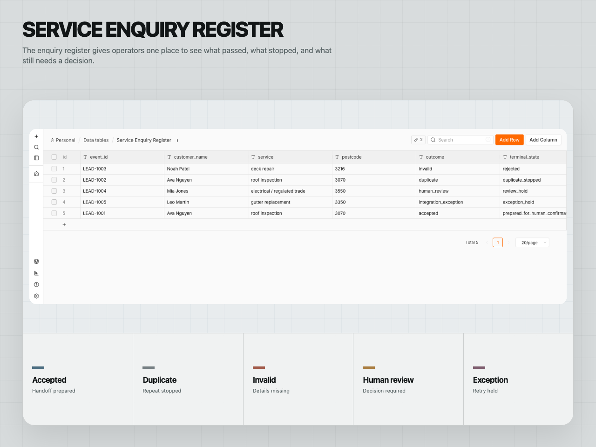

# n8n Service Enquiry Intake and Routing

An inactive, import-tested n8n system for structured quote intake, persistent
duplicate control, human review, exception holds, and recorded operator
outcomes.

**Status:** Provider-verified in an isolated local n8n 2.31.6 instance; workflows remain inactive.

**My contribution:** Workflow design, form intake, routing controls, QA scenarios, and operator handoff.

## Five enquiries, one prepared handoff

The [committed expected output](fixtures/expected-output.json) records five synthetic enquiries. One prepared CRM and booking actions for review. The others were stopped as duplicate, invalid, held for human review or held after a destination failure. All five recorded zero external actions.



*Retained operator register from the isolated n8n 2.31.6 run. Both public workflows remain inactive. The [intake form](assets/customer-intake.png) and [provider evidence](docs/evidence.md) are also available.*

## How it works

### Routing model

The 20-node main workflow captures a service enquiry through a structured n8n
form, normalises the record, checks a local enquiry register, and routes it to
one of five explicit outcomes before any external handoff is prepared.

| Outcome | Treatment |
| --- | --- |
| Accepted | Prepare CRM, booking, and acknowledgement handoffs for human confirmation |
| Duplicate | Stop a repeated contact-and-service combination |
| Invalid | Record missing contact or consent details |
| Human review | Pause regulated or unclear work for an explicit decision |
| Integration exception | Hold a simulated destination failure for review |

Every outcome is written to the local `Service Enquiry Register` with
`external_actions_performed: false`.

The expected output records correlation IDs, duplicate keys, route decisions,
prepared actions, and whether any external action occurred.

## Implementation

- [`workflow/workflow.json`](workflow/workflow.json) — the inactive 20-node
  customer-intake and routing workflow;
- [`workflow/qa-workflow.json`](workflow/qa-workflow.json) — the inactive
  15-node five-scenario QA harness;
- [`workflow/data-table-schema.json`](workflow/data-table-schema.json) — the
  local operator-register schema.

The node counts include layout notes. Neither workflow contains credentials or
external provider nodes. Data Table identifiers belong to the isolated local
proof instance and must be relinked after import into another n8n instance.

```text
workflow/        inactive main workflow, QA workflow, and Data Table schema
fixtures/        five controlled input and expected-output records
scripts/         structural and safety-boundary validator
assets/          matched case-study visuals and native n8n evidence
docs/            architecture and activation notes
```

[Node map and activation notes](docs/architecture.md)

## Validation

```bash
node scripts/validate-workflow.mjs
```

Import the two workflow JSON files through n8n's import screen and relink the local Data Table using the supplied schema. Keep both workflows inactive until adapters and readback checks are approved. The structural validator does not repeat the historical provider execution.

## Scope and current state

The controlled synthetic run produced one accepted, duplicate, invalid, human-review and integration-exception row, including the Wait-node review path. It performed no external actions. No production deployment, live CRM/calendar writes, customer messaging or ROI is claimed.

## Documentation

- [Node map and activation notes](docs/architecture.md)
- [Evidence index](docs/evidence.md)
- [smsystems.au/work/n8n-service-lead-routing](https://smsystems.au/work/n8n-service-lead-routing/)
