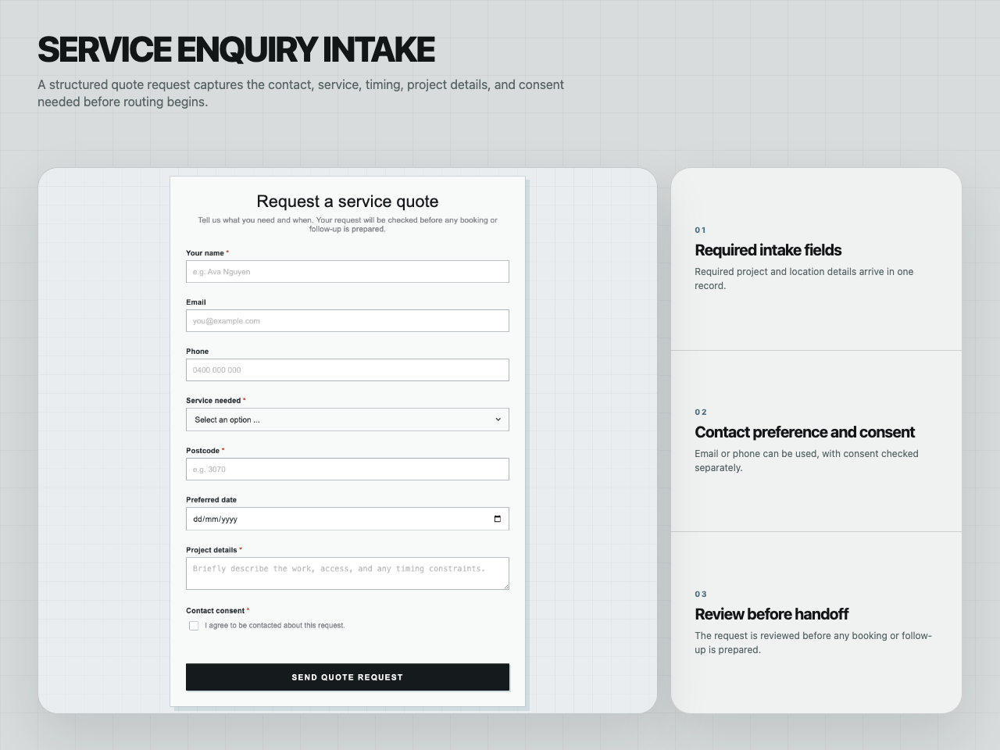
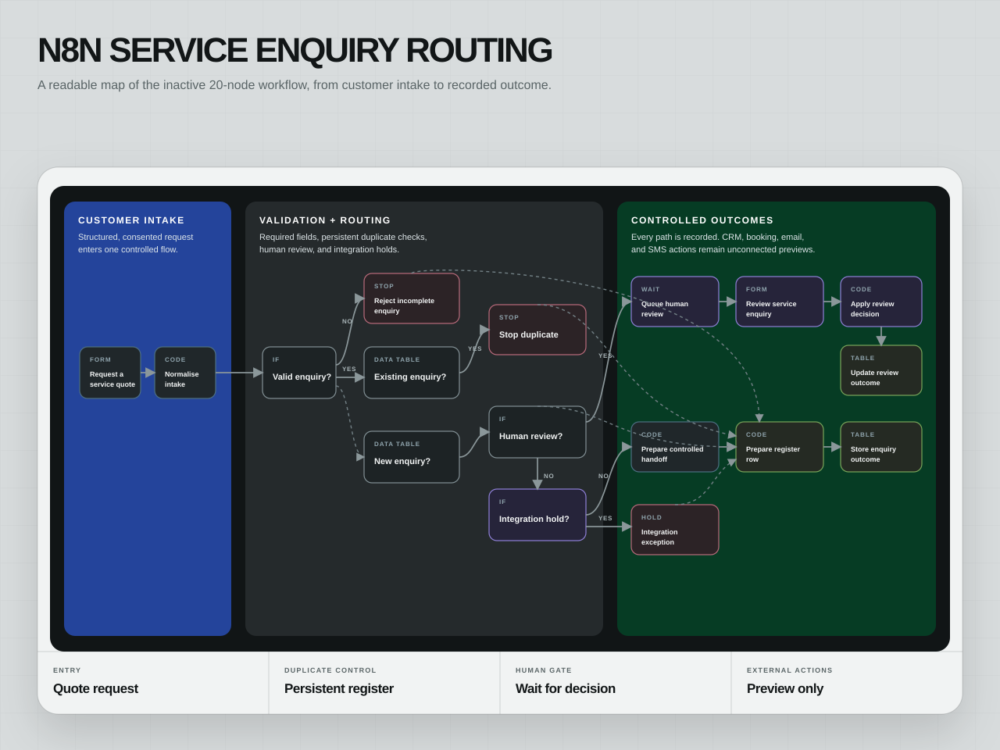
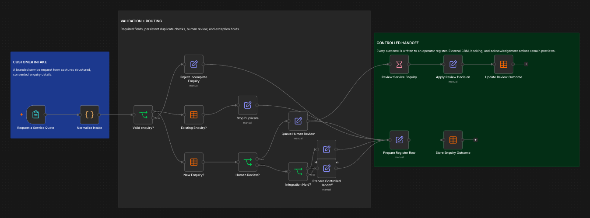
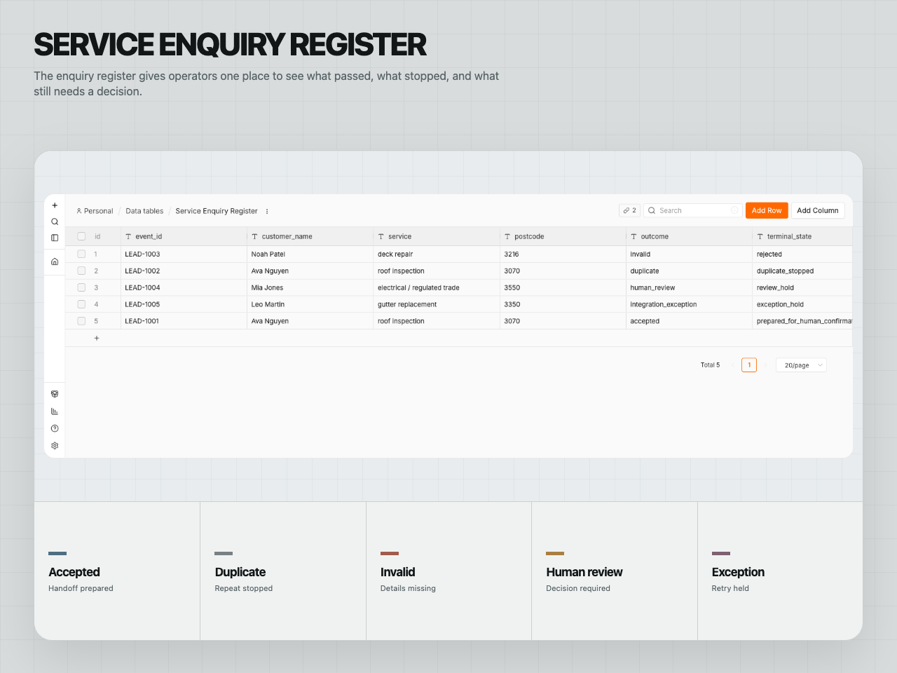
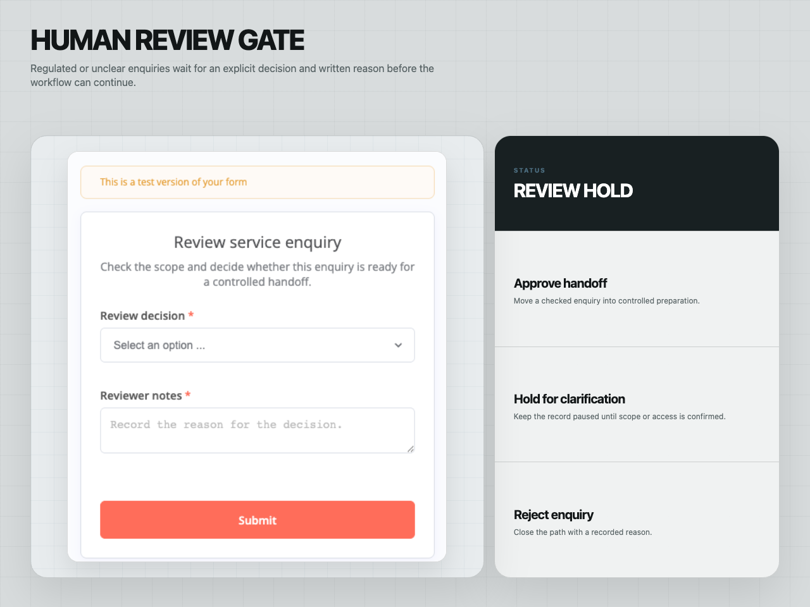

# n8n Service Enquiry Intake and Routing

An inactive, import-tested n8n system for structured quote intake, persistent
duplicate control, human review, exception holds, and recorded operator
outcomes.

| | |
| --- | --- |
| Status | Provider-verified in an isolated local n8n 2.31.6 instance; inactive |
| Role | Workflow design, form intake, routing controls, QA scenarios, and operator handoff |
| Stack | n8n Form Trigger, Data Tables, Wait forms, JavaScript, JSON contracts |
| Project page | [smsystems.au/work/n8n-service-lead-routing](https://smsystems.au/work/n8n-service-lead-routing/) |



## Routing model

The 20-node main workflow captures a service enquiry through a structured n8n
form, normalises the record, checks a local enquiry register, and routes it to
one of five explicit outcomes before any external handoff is prepared.



| Outcome | Treatment |
| --- | --- |
| Accepted | Prepare CRM, booking, and acknowledgement handoffs for human confirmation |
| Duplicate | Stop a repeated contact-and-service combination |
| Invalid | Record missing contact or consent details |
| Human review | Pause regulated or unclear work for an explicit decision |
| Integration exception | Hold a simulated destination failure for review |

Every outcome is written to the local `Service Enquiry Register` with
`external_actions_performed: false`.

## Provider-native evidence

The readable map above is derived from the committed workflow so its labels
remain clear at portfolio size. The corresponding provider-native n8n canvas
capture is retained below for implementation evidence.



The controlled proof run also produced an operator register with exactly one
accepted, duplicate, invalid, human-review, and integration-exception row, plus
a completed Wait-node review form path.





## Included workflows

- [`workflow/workflow.json`](workflow/workflow.json) — the inactive 20-node
  customer-intake and routing workflow;
- [`workflow/qa-workflow.json`](workflow/qa-workflow.json) — the inactive
  15-node five-scenario QA harness;
- [`workflow/data-table-schema.json`](workflow/data-table-schema.json) — the
  local operator-register schema.

The node counts include layout notes. Neither workflow contains credentials or
external provider nodes. Data Table identifiers belong to the isolated local
proof instance and must be relinked after import into another n8n instance.

## Included scenarios

The committed fixture covers:

- an accepted website enquiry;
- a duplicate submission with case-normalised email;
- missing contact method and consent;
- a complete enquiry requiring human review;
- a simulated destination-adapter failure.

The expected output records correlation IDs, duplicate keys, route decisions,
prepared actions, and whether any external action occurred.

## Validate and import

Run the structural and claim-boundary checks:

```bash
node scripts/validate-workflow.mjs
```

Import the two workflow JSON files through the n8n workflow import screen,
create or relink the local Data Table from the supplied schema, and keep both
workflows inactive until destination adapters and readback checks are approved.

## Safety boundary

This repository proves an isolated local implementation and controlled
synthetic executions. It does not claim a production deployment, live CRM or
calendar writes, customer data, external messages, client delivery, lead
growth, or ROI.

## Repository contents

```text
workflow/        inactive main workflow, QA workflow, and Data Table schema
fixtures/        five controlled input and expected-output records
scripts/         structural and safety-boundary validator
assets/          matched case-study visuals and native n8n evidence
docs/            architecture and activation notes
```

[Node map and activation notes](docs/architecture.md)
